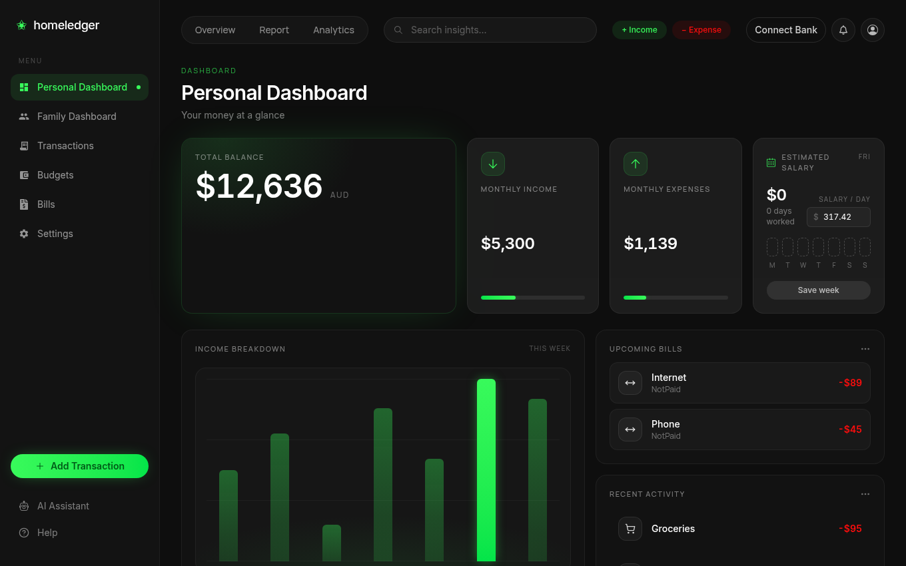
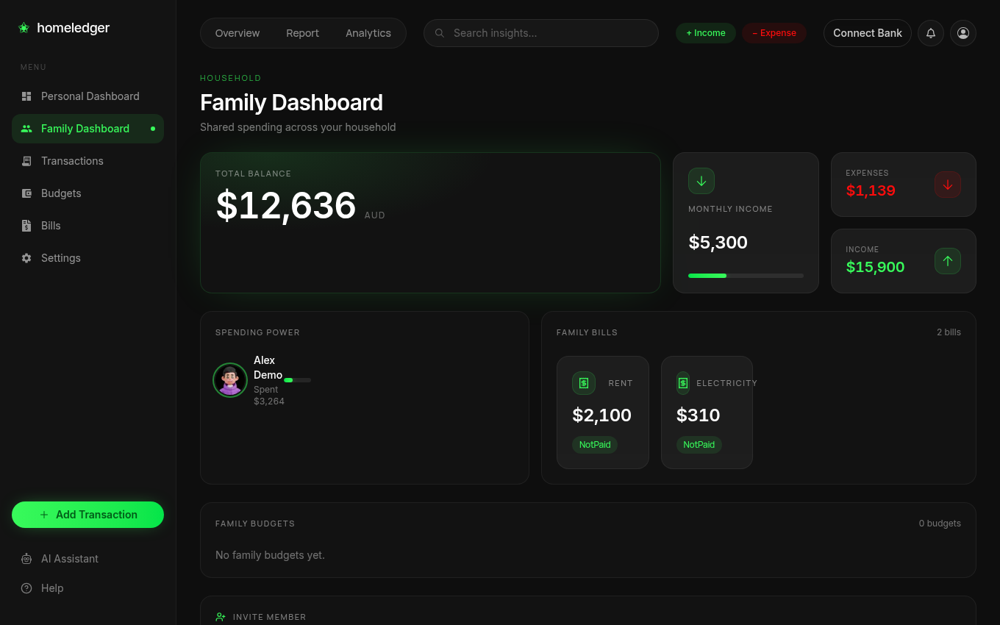
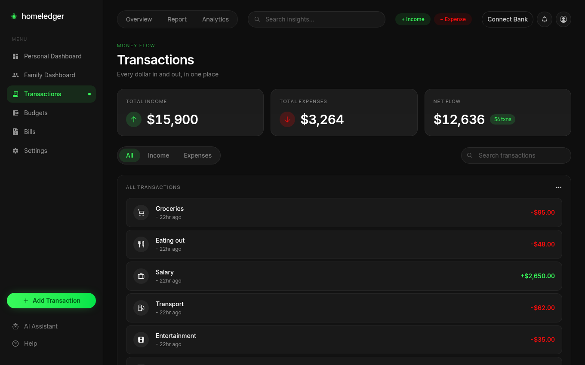

# HomeLedger

A personal and family finance app. Track income, spending, budgets and bills on your own, or share a household view with your family.

This is the Next.js web client. The backend is in [homeledger-api](https://github.com/zmyn-ahmadi/homeledger-api).



| Family dashboard | Transactions |
| --- | --- |
|  |  |

## Run it

You only need Docker. One command in the API repo starts the whole app with an invented household:

```bash
git clone https://github.com/zmyn-ahmadi/homeledger-api.git
cd homeledger-api
docker compose up --build
```

Open http://localhost:3000 and log in with `demo@homeledger.local` / `Demo1234!`.

## Features

- **Personal dashboard:** balance, monthly income and spending, upcoming bills and recent activity.
- **Family dashboard:** shared bills, household totals, and invite links for new members.
- **Transactions:** income and expenses in one searchable list.
- **Budgets and bills:** spending limits by category, and recurring bills.
- **Work tracker:** log days worked to estimate salary.
- **Bank connection:** link accounts through Basiq (needs your own API key).
- **AI assistant:** a streaming chat page that works with any OpenAI-compatible server, such as a local Ollama model. It answers general questions and doesn't read your financial data yet.

## How it works

```
Browser ──► Next.js (pages, API routes, session handling) ──► ASP.NET Core API ──► PostgreSQL
```

The browser talks to Next.js API routes rather than the backend directly, so tokens stay on the server side.

## Built with

TypeScript, Next.js 16, React, Tailwind CSS and Docker.

## Develop without Docker

Run the API first, then:

```bash
pnpm install
pnpm dev
```

Set these in `.env.local`:

| Variable | Purpose |
| --- | --- |
| `API_URL` | Backend address |
| `JWT_SECRET`, `JWT_ISSUER`, `JWT_AUDIENCE` | Must match the API's JWT settings |
| `NEXT_PUBLIC_BASE_LLM_URL`, `NEXT_PUBLIC_MODEL`, `NEXT_PUBLIC_MAX_TOKENS` | Optional, for the chat page |

## Known limits

- The Income Breakdown chart on the personal dashboard uses placeholder data.
- The Budgets page compares all spending to date against the monthly limit, and its month label is fixed.
